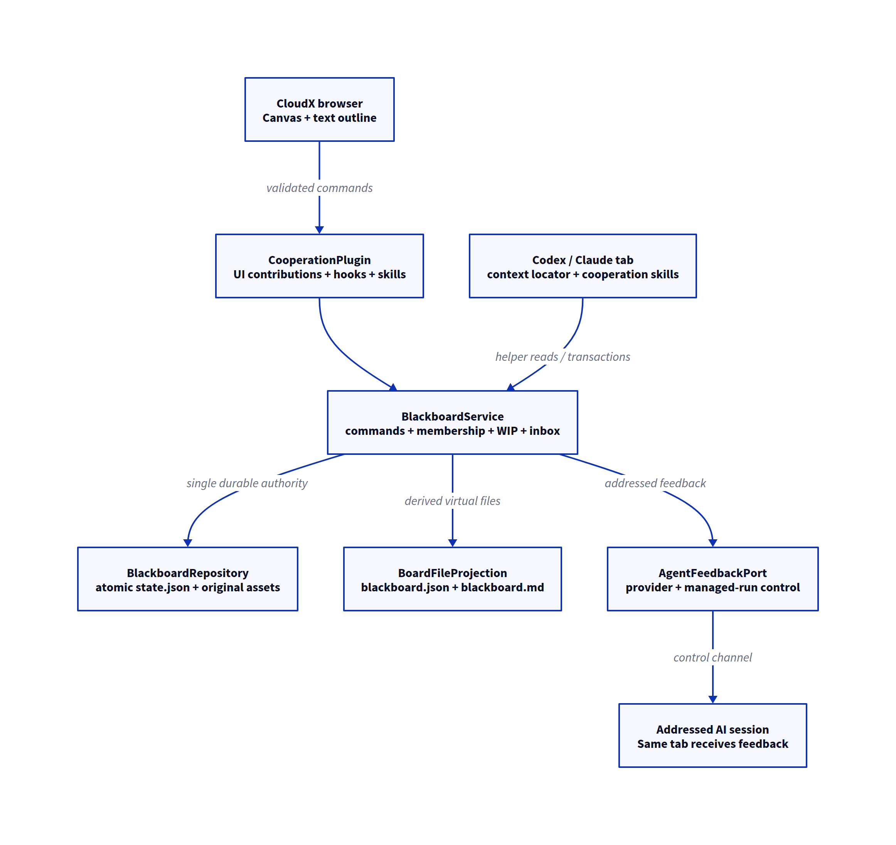
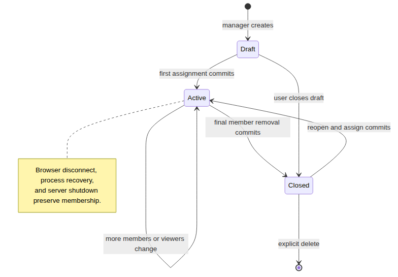

# Cooperation plugin: architecture and ownership

## Design boundary

**Proposal for the current CloudX worktree.** Implement Cooperation as a built-in WorkspacePlugin composed with the server, shared contracts, and a native React renderer. The current GitHub manifest installer is metadata-only; this design does not assume it can execute a new third-party plugin. The requested deliverable is this architecture, the rollout plan, draft skills, and examples. No runtime feature is added by these files.

Use one mutation authority, BlackboardService. Browser edits and skill writes reach the same command boundary. The service owns board contents, assignments, permission checks, WIP constraints, inbox events, operation receipts, and lifecycle. Rendering, transport, provider adapters, and filesystem projections do not become additional owners.

Proposed ownership and data paths. The provider delivery port is required implementation work.

## Components and responsibilities

Proposed classes and adapters.

| Component | Owns | Does not own |
|----|----|----|
| CooperationPlugin | Plugin descriptor, hooks, system skill/rule contributions, manager/view sessions. | Document persistence or provider process control. |
| BlackboardService | Validated transactions, membership generations, WIP policy, question routing and durable inbox. | React state or terminal input. |
| BlackboardRepository | Serialized state mutation, atomic replacement, original assets and receipt lookup. | Agent instruction policy. |
| BoardFileProjection | Deterministic JSON/Markdown projections from a committed state generation. | Independent edits or a separate journal. |
| AgentCooperationContext | Per-tab context files, logical capabilities, current assignment generation. | Provider/account identity or board ownership. |
| AgentFeedbackPort interface | Acknowledge delivery to one provider session/managed attempt at a verified input boundary. | Question resolution or content changes. |
| CodexFeedbackAdapter / ClaudeFeedbackAdapter | Exactly one configured native control path per provider and capability handshake. | Fallback terminal typing or hidden one-shot sessions. |
| ManagedAgentFeedbackAdapter | Delegate to the owning plugin’s run/attempt state machine. | Bypass owner workflow gates. |
| BlackboardCanvasAdapter | Project domain items/relations onto React Flow and pointer ink. | Store React Flow objects as the file contract. |
| BoardGeometry | Shared deterministic item, port, ink, polyline and label bounds for validation and rendering. | Browser-only routing or unbounded drawing overflow. |
| BlackboardViewState | Camera, selection, editor drafts, transient ink, collapsed tools, per-view seen cursor. | Authoritative board content. |

Suggested production locations are apps/server/src/cooperation for the domain/store/delivery modules, apps/server/src/plugins/CooperationPlugin.ts for the adapter, packages/shared/src/cooperation.ts for serialized contracts and validators, and apps/web/src/ui/cooperation for the view/controller. Add reusable host lifecycle/context/delivery interfaces to packages/plugin-api only when their callers are concrete. Keep the diagram editor separate from AutomationPanel’s workflow model.

## Storage and the virtual file

For v1, keep one guarded atomic state.json under the fixed CloudX cooperation data directory. It contains the board documents, the tab-to-board assignment map, a monotonic assignment-generation counter per tab, durable feedback state, recent board events, and operation receipts. All mutations pass through a single repository queue. This deliberately uses the existing atomic JSON infrastructure instead of introducing a database or a custom write-ahead log.

Each board exposes `boards/<boardId>/blackboard.json` and blackboard.md on disk as derived virtual files. The JSON is complete and lossless; Markdown is a readable projection with stable object IDs and image locators. The skill’s helper reads the committed board and writes operations that update the same virtual document. Blind editor replacement of either projection is unsupported. A per-tab context file points to the board; many contexts can point to one board. The [file protocol](file-protocol.md) defines exact write and failure semantics.

The authority file and projections are not a cross-file transaction. Persist state first, then publish projections, then acknowledge the normal write and emit its event. If projection publication fails after commit, return COMMITTED_PROJECTION_UNAVAILABLE with the committed receipt; do not claim rollback. Pause board writes until explicit repair. On startup, rebuild derived files from validated state before accepting operations. A revision/hash mismatch is a visible integrity error; it must not import arbitrary disk changes into the board.

## Membership and lifecycle

Proposed lifecycle. Board viewers do not contribute to the member count.

Assign(tabId, boardId, expectedGeneration) is one transaction over the single authority file. Confirm that the original target tab still exists, update its generation, release any previous board, bind the new one, and close the old board if that removal leaves it empty. No intermediate state publishes a detached tab or double membership. Generate fresh capabilities for the new generation; revoke old delivery claims. Member arrays in board projections are derived from the assignment map, not another authority.

The host owns whether a tab exists. Subscribe to committed tab removal, not a terminal exit callback. A failed close keeps membership. Server shutdown cancels sockets and deliveries while preserving assignments. Startup needs a restoration barrier for both saved user tabs and owner-managed sessions; only after each owner reports its complete restored set may the service reconcile missing IDs. Persist a close intent with an operation ID when coordinating host close and board cleanup, so a crash after termination can finish reconciliation without resurrecting a deleted tab.

For plugin-owned tabs, the owning plugin supplies authoritative live tab/run bindings at the same barrier. A recoverable worker with a retained tab remains a member. A finished worker whose tab is removed releases membership. If a managed continuation changes tab IDs, transfer the assignment atomically before closing the old tab. Do not infer membership from provider conversation IDs, attempt IDs, pane IDs, or a temporary empty registry.

## Current host extension points

Required host changes; all are proposed, not existing capabilities.

| Host surface | Required change |
|----|----|
| Agent tab context menu | Turn the account-specific menu into a common agent menu with a Blackboard section, independent of agent-accounts availability. Include owned tabs for board actions while preserving switch restrictions. |
| Contribution registry | Register cooperation.panel, tab badge, and settings/actions with explicit target matching. A renderer descriptor alone does not implement a view. A new panelKind is not needed merely for this panel. |
| Runtime context resolver | Compose rules-skills context with AgentCooperationContext. Keep an immutable per-tab locator in both provider launches so live assignment reads do not depend on changing process environment. |
| Assignment metadata | Use a dedicated binding command. Generic updateTabPluginMetadata currently submits a runtime-update prompt; board changes must not enter that path. |
| Session lifecycle | Expose committed removal, restoring/ready barriers, stable tab identity, and provider/owner changes without conflating shutdown detach with close. |
| Provider feedback | Add AgentFeedbackPort and owner coordination; existing enter_text and quiet-output readiness do not establish safe automatic message delivery. |
| Transport and assets | Dedicated board revision subscriptions and board-owned image upload/read/resolve boundaries. Existing file-browser routes do not serve this storage. |

The current source behind these decisions is recorded in [Research and decisions](research.md). Compose new owners in server.ts. Keep Fastify/WebSocket validation and error mapping thin; keep browser calls in the API layer. Share contracts rather than duplicate browser/server shapes.

## Feedback delivery and provider parity

A user-authored question chooses one responder: the target’s author if that tab is still assigned, otherwise the board’s selected responder. If neither exists, retain an unassigned question and ask the user to select a member. Other members can read it but do not all wake up. User-authored question/reply/Ready actions may request a response. Pointer motion, each pen point, plain agreement, and AI-authored changes never automatically wake peers.

AgentFeedbackPort accepts an envelope with event IDs, board revision, assignment generation, target IDs/quotes, and recipient identity. It reports unavailable, queued, accepted by native transport, or unknown after interruption. A helper inbox claim proves the agent read the event; a committed thread answer proves a response exists. Those are separate from delivery acceptance. Publish each state so a queued question is never shown as read.

For Codex, extend the existing broker/control owner rather than attach a competing frontend to its single-frontend bridge. Queue a new addressed turn at idle; busy feedback is retained until a supported boundary unless the user explicitly chooses immediate steering. Any steering must match the current turn identity. For Claude, prototype a session-bound native event channel with the official channel interface. This is a proposed adapter, not a claim that current hooks or launch policy already enable it. The provider capability gate in the implementation plan must establish supported versions, authentication, organization policy, and plugin/skill exposure.

Native channel restrictions can block the proposed Claude adapter on a supported installation. If so, revise the transport decision before shipping full automatic feedback; do not silently substitute polling, PTY text, another agent, or a new independent AgentExec session. All Codex/Claude tabs remain in scope. Initial skill/file access can be developed independently, but automatic feedback and managed-run support are required for the full release.

In particular, the documented custom-channel preview needs an approved allowlist route for production. Its development override requires interactive confirmation and does not operate in print/SDK mode. The plugin must not enable that override automatically. M0 must either prove an approved channel path for the required installations or replace the proposed Claude transport through a new evidence-backed decision. See the primary-source details in the research document.

A managed-run adapter must coordinate with its owner. The current worker paths have single-turn assumptions. The owner must either accept a message into the active attempt through its tested control boundary or schedule a legitimate continuation under its normal workflow/receipt rules. An idle or finished attempt must not receive an untracked second turn. A continuation answer records the original tab/owner/attempt lineage. This work is part of the delivery milestone, not an exclusion of managed tabs.

## Trust, resources, and explicit failure

Bind helper requests to a per-tab logical capability, board ID, and current assignment generation. Verify the capability and current membership server-side on every read, write, asset resolve, and inbox operation. Browser requests use the existing trusted-origin policy plus captured target IDs. Keep capabilities out of projections, browser snapshots, logs, and notes. Same-user agents with broad filesystem access are not isolated from each other by these tokens; the design does not claim an OS security boundary.

Capture provider/owner/attempt lineage in durable operation and delivery receipts, separate from the actor’s stable tab ID. A provider switch cancels obsolete in-flight delivery handles without reassigning the board. A same-logical-run owner transfer is explicit and atomic; ordinary sibling/fork creation does not inherit access. Historical actor IDs remain readable even when their tabs no longer exist.

Use a fixed managed data root, generated IDs, canonical containment, no-follow regular-file checks, bounded JSON, and bounded image decoding. Treat note text, links, code, clipboard HTML, image metadata, and source citations as data. Sanitize rendered Markdown; never execute code blocks or load remote images from content. User management commands may assign, close, reopen, delete, or release a user WIP region. The authoritative host lifecycle also closes a board after final-member removal. Agent content commands cannot perform those management transitions.

Use the provisional limits in the file protocol as measurable resource budgets, not claims of measured capacity. Reject oversized transactions before mutation. Retain originals through board close; explicit deletion removes a closed board and its exclusively owned assets after active reads stop. Do not add a periodic purge or hidden auto-delete policy. A corrupt authority file blocks mutation with a clear repair/export path; do not guess an older state or create an empty board in its place.
