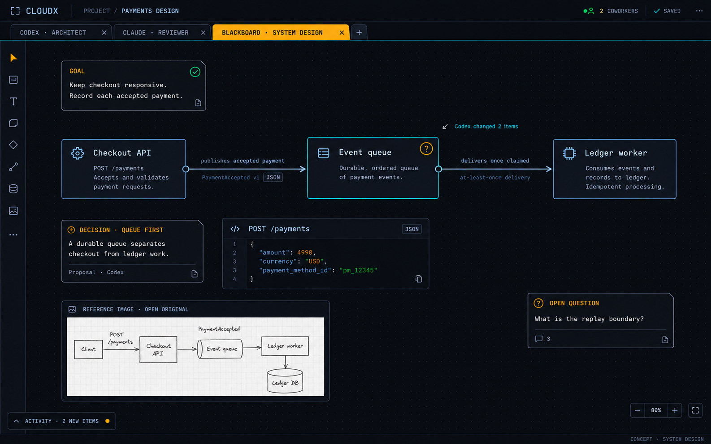
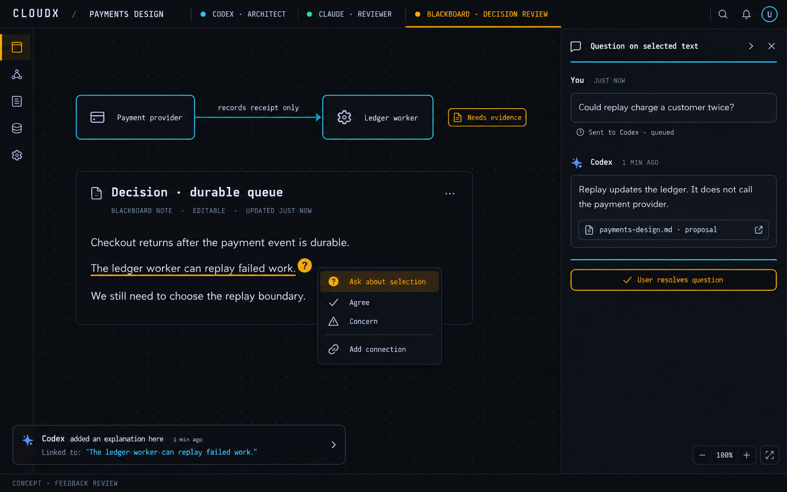
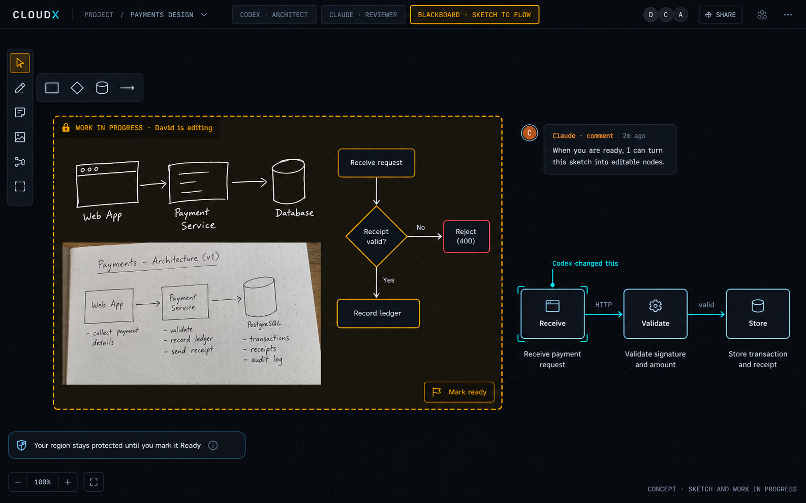
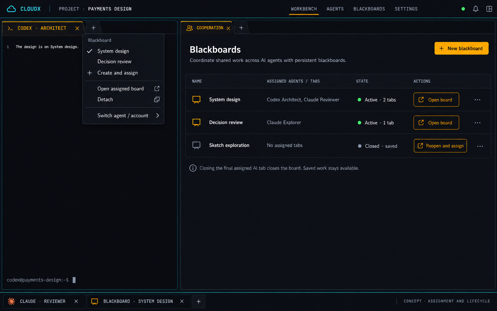

# Blackboard visual templates

These four PNGs were generated with the built-in imagegen tool and reviewed as product concepts. They show the proposed Cooperation plugin in CloudX’s dark, compact workbench. They are not screenshots of a running feature. The normative behavior is in the [interaction design](design.md).

The exact prompt set is saved in [prompts.json](visuals/prompts.json). All project assets are stored in this repository. No CLI image-generation path or pixel edits were used.

## System design

[Open full image](visuals/01-system-design.png). Use this template to discuss responsibilities and relationships. The [semantic example](examples/system-design.json) makes notes, code, images, shapes, and custom-described connections inspectable as text. Payment details are illustrative proposals.

## Question and decision review

[Open full image](visuals/02-feedback-review.png). The selected phrase keeps its own question and answer. The [semantic example](examples/decision-review.json) includes stable anchors and a Unicode selection. The generated image combines queued and answered states to show the flow; production state must distinguish them and use consistent timestamps. A proposal source chip does not prove a file exists.

## Sketch and work in progress

[Open full image](visuals/03-sketch-work-in-progress.png). The [semantic example](examples/sketch-wip.json) preserves strokes, shapes, the WIP region, and a separate AI comment. Border labels and dash patterns carry meaning alongside color. The generated Share affordance is outside the initial scope; it does not add remote collaboration or publication to this plan.

## Assignment and board manager

[Open full image](visuals/04-assignment-and-manager.png). Use this view to review create/assign/open/detach actions, many tabs sharing one board, and automatic close with saved work retained. Preserve CloudX’s existing pane/tab navigation in implementation; decorative navigation and generated wording are not an API contract.

The review checked readable content, CloudX styling, compact tools, target-specific feedback, and unobstructed WIP content. Actual keyboard behavior, touch, contrast, narrow panes, save status, provider delivery, and focus need browser/native evidence during implementation. Mockups cannot establish those properties.
