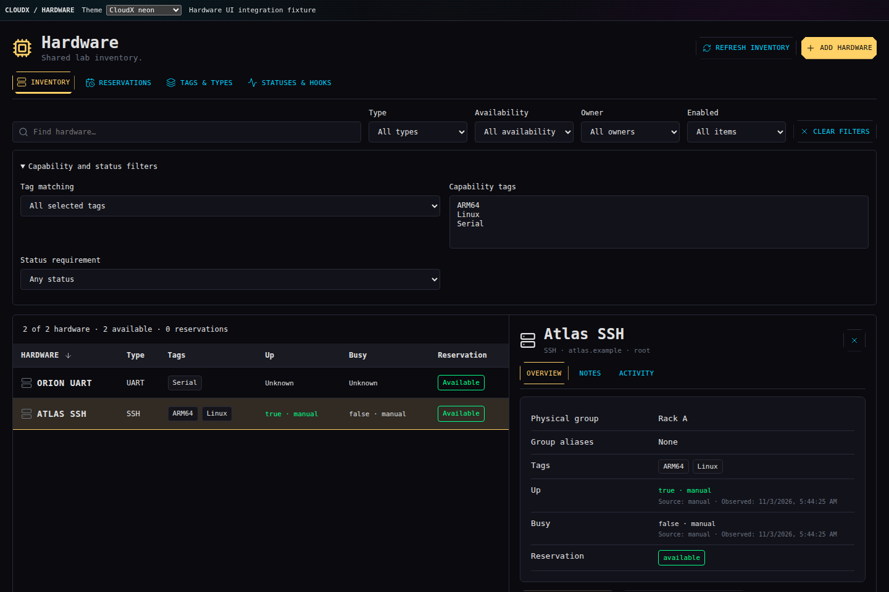
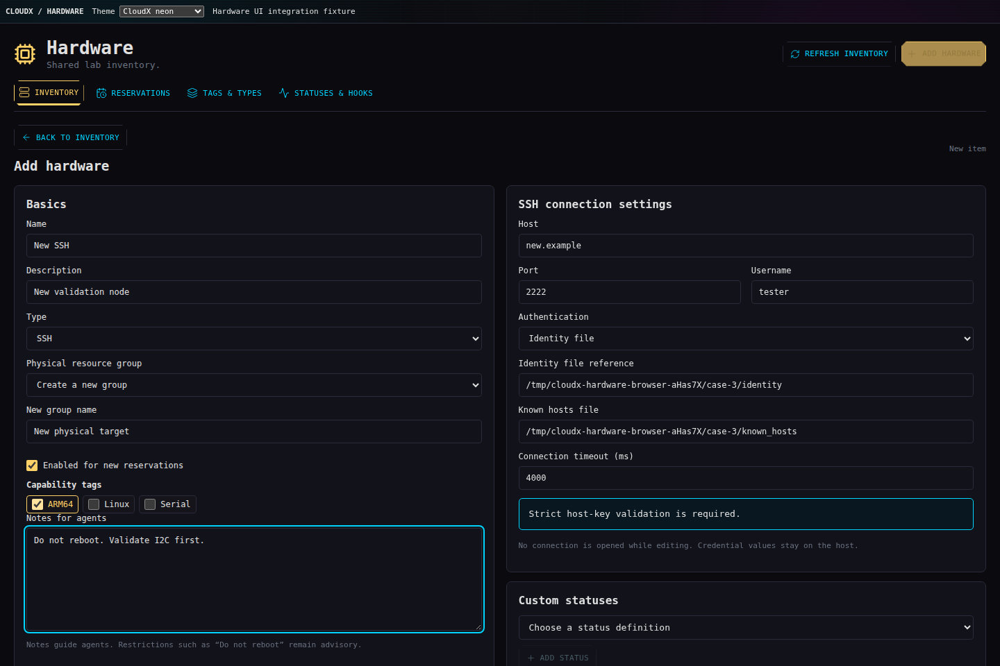
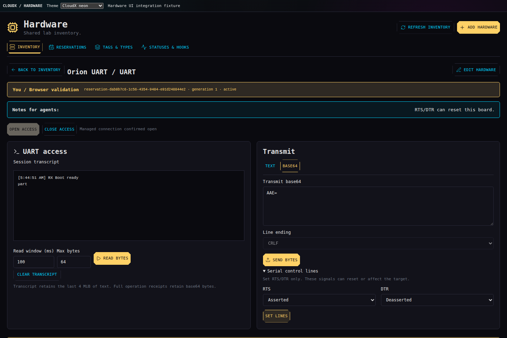
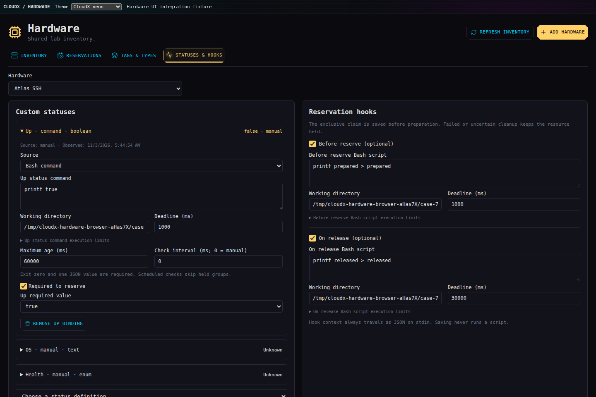
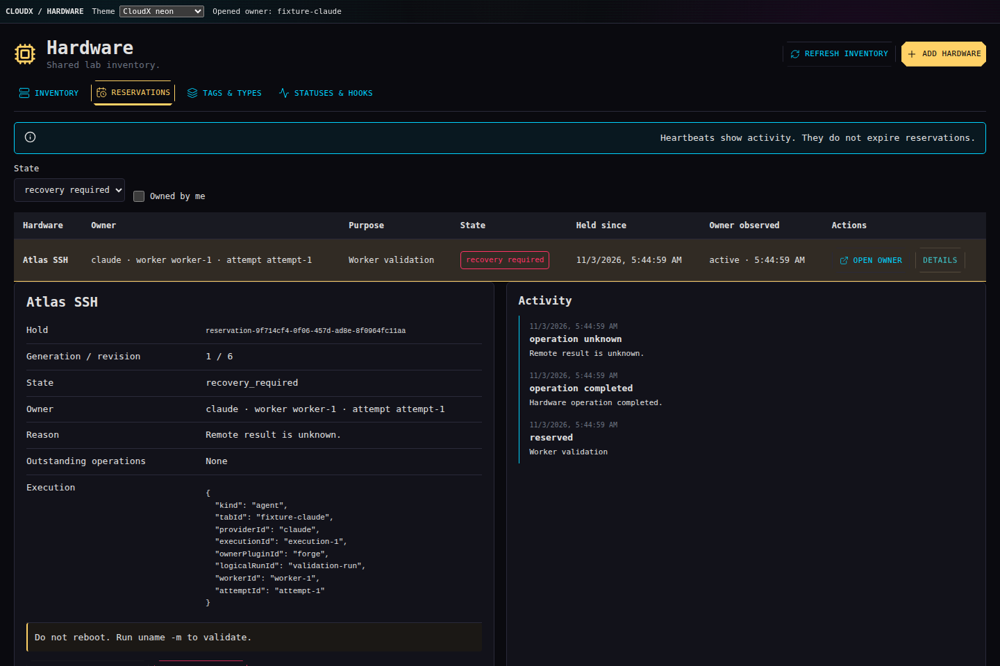
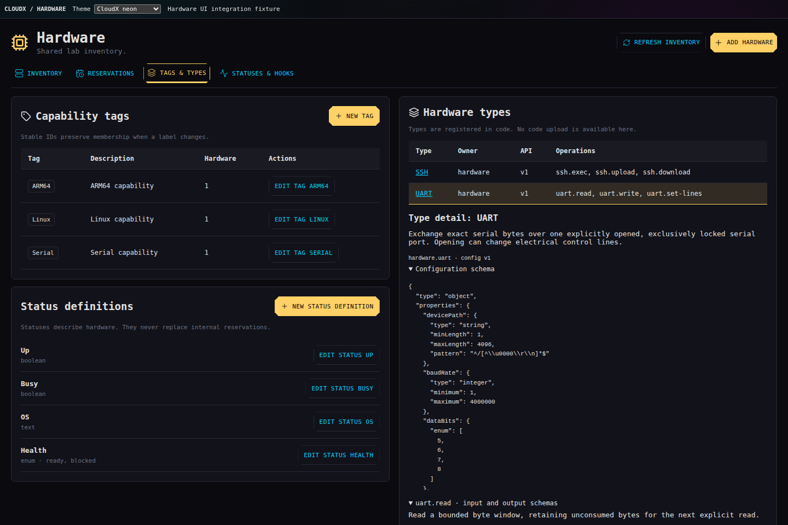
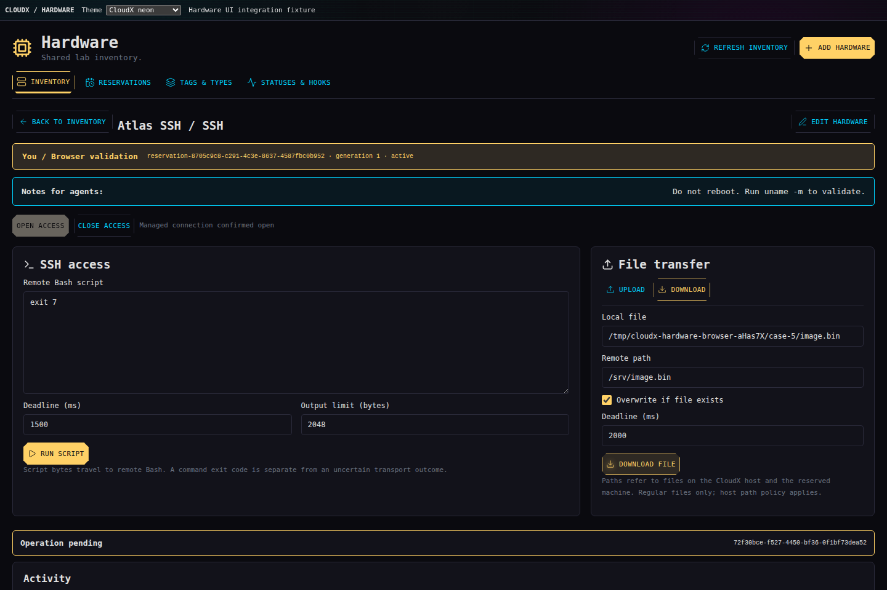

# Hardware implementation gallery

These screenshots show the running native Hardware panel in the CloudX Neon theme at a desktop viewport. The browser harness uses production HTTP routes, persistence, reservation logic, and Bash hooks. Device I/O is emulated. The original imagegen concepts remain linked for comparison.

## Inventory and notes

[Original concept](../visuals/01-inventory.png) · [Full screenshot](01-inventory.png)

## SSH editor

[Original concept](../visuals/02-ssh-editor.png) · [Full screenshot](02-ssh-editor.png)

## UART access

[Original concept](../visuals/03-uart-access-v2.png) · [Full screenshot](03-uart-access.png)

## Statuses and hooks

[Original concept](../visuals/04-statuses-hooks.png) · [Full screenshot](04-statuses-hooks.png)

## Reservations and recovery

[Original concept](../visuals/05-reservations.png) · [Full screenshot](05-reservations.png)

## Tags, types, and physical groups

[Original concept](../visuals/06-tags-types-v2.png) · [Full screenshot](06-tags-types.png)

## SSH execution and transfers

[Original concept](../visuals/07-ssh-access.png) · [Full screenshot](07-ssh-access.png)

