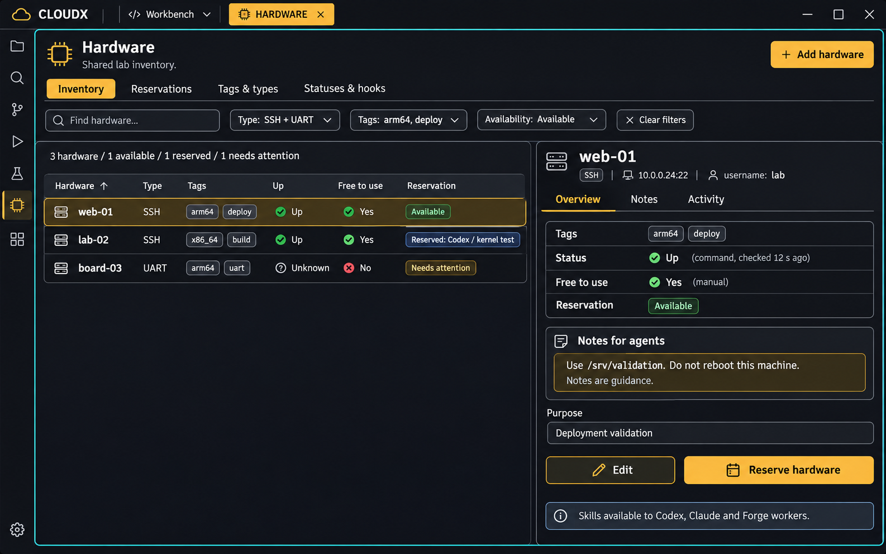
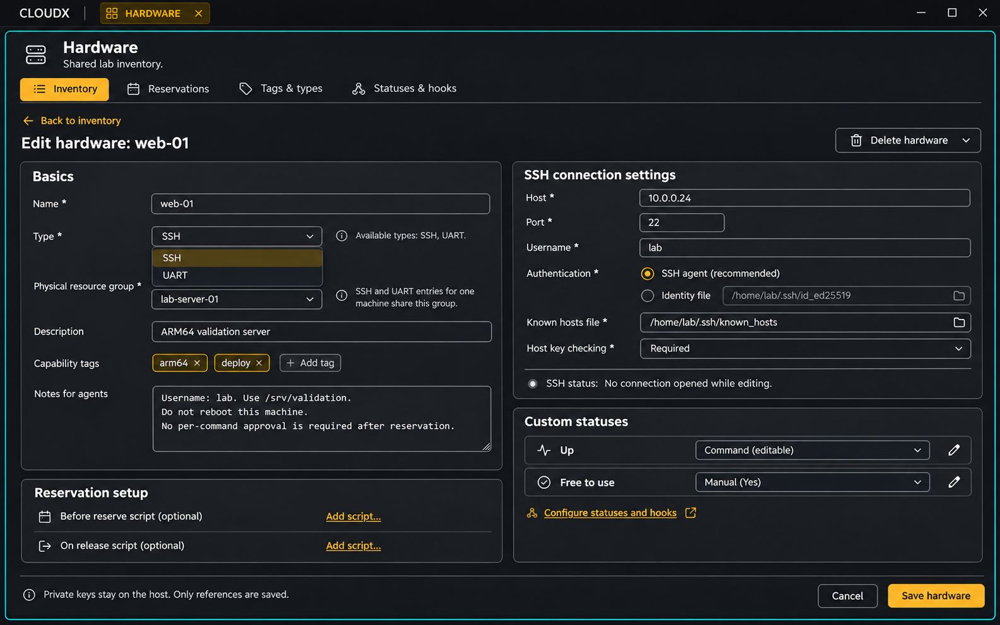
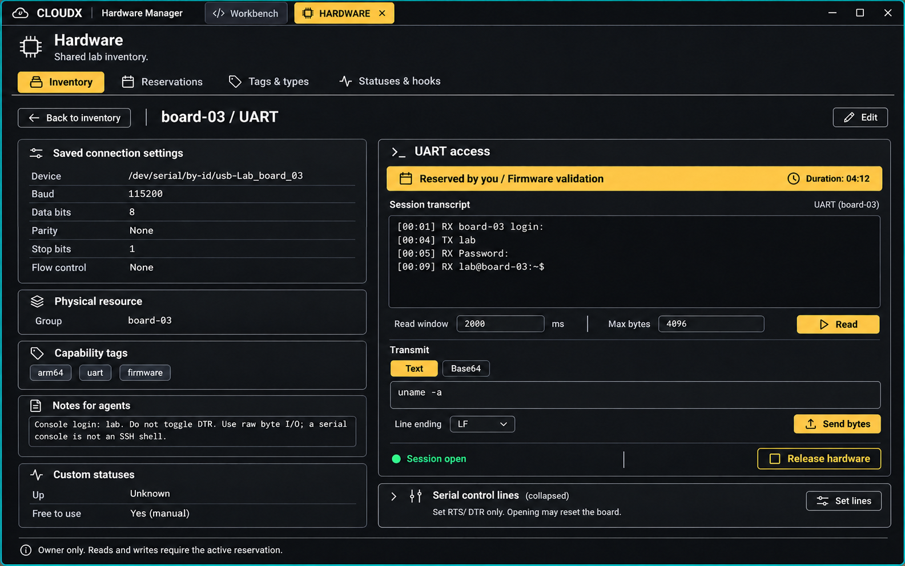
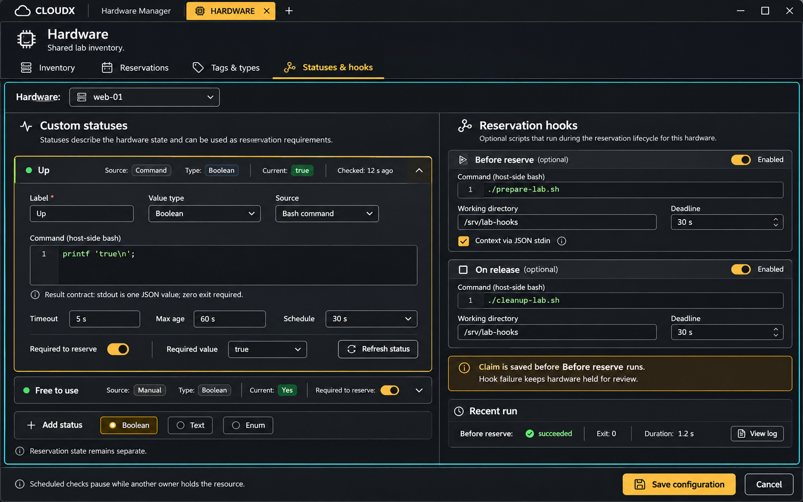
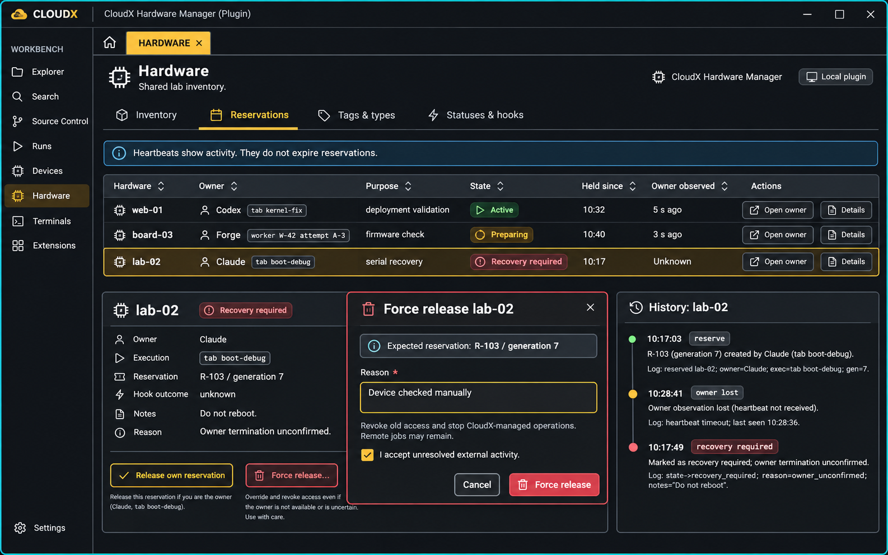
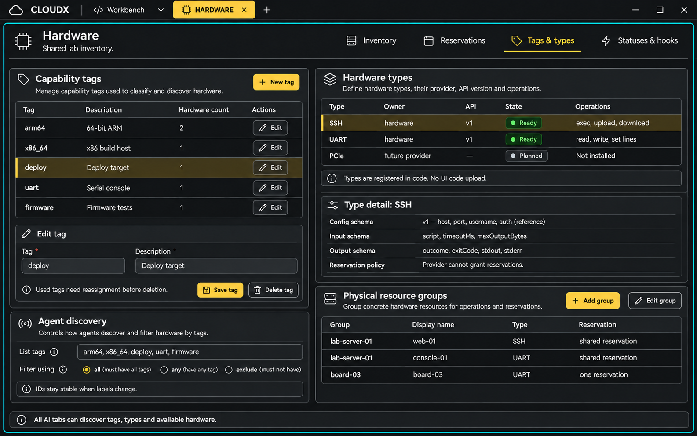
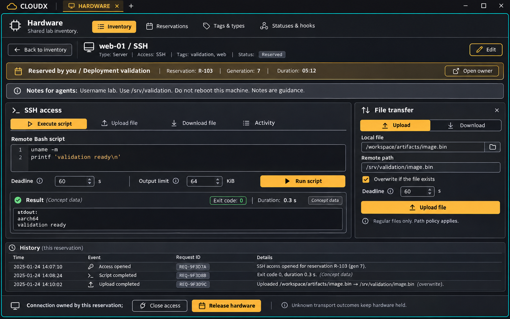

# Hardware plugin screen designs

## Overview

Seven final screen concepts were generated with the built-in imagegen tool. These are product design images, not screenshots of an implemented plugin. The [exact prompts and edits](visuals/prompts.json) identify built-in generation and the final selected files. All final PNGs are stored with this design package.

## Inventory and item notes

Inventory and item notes concept. Proposed behavior only.

The Inventory view provides Add hardware, text/type/tag/status/availability filters, a sortable list, and the selected-item inspector. Show full notes, login metadata, status source/freshness, purpose, and Reserve. The green Available badge is computed from eligibility and absence of conflicting holds. Free to use is an independent custom status. Counts and rows in this concept demonstrate different states; production counts must clearly identify whether they cover the whole inventory or the filtered result.

## SSH item editor

SSH item editor concept. Proposed behavior only.

Create and edit share one form. Changing Type selects the provider’s validated fields; selecting UART replaces SSH fields with device path and serial settings. Include description, enabled state, group creation/selection, tags, notes, status bindings, and optional scripts. Do not connect during editing. Freeze connection/group/hook/status-binding edits while held. Show field errors and stale-save conflicts explicitly. Delete is disabled while held and requires an explicit target.

## UART settings and reserved access

UART settings and reserved access concept. Proposed behavior only.

The UART editor uses the settings listed at left. In the saved item view, explicit Open access creates the connection after reservation; the concept shows that connection already open. Read windows and output sizes are bounded. Text mode creates exact bytes using the selected line ending; base64 mode leaves bytes unchanged. Set lines controls RTS/DTR only. Opening can reset some boards, so sensitive workflows need board evidence. UART does not invent shell exit codes.

The example transcript and login text are illustrative. It does not assert that a machine is connected or that a password was supplied. The imagegen edit corrected the original control-line subtitle; the original unused variant is not a delivered asset.

## Statuses and reservation scripts

Statuses and reservation scripts concept. Proposed behavior only.

Each binding selects a stable definition and manual or command source. Expose boolean/text/enum configuration, required value, maximum observation age, check schedule, deadline, working directory, and output limit. Distinguish status JSON output from hook diagnostic output. The image shows a sample command and relative script names inside explicit host-side working directories.

The plugin always passes structured hook context on stdin; the pictured checkbox is a concept label, not an optional protocol setting. Saving script configuration does not execute it. A status Refresh uses the exclusion gate. Do not add a test-hook shortcut that executes preparation outside a saved claim. Recent run logs show actual receipts during implementation; the image’s success/exit/duration values are invented sample data.

## Reservation monitor and override

Reservation monitor and override concept. Proposed behavior only.

Show exact owner/worker-attempt links, purpose, phase, acquisition time, last owner observation, and operation history. Ordinary release is available only to the current owner. The operator can select Force release against the displayed claim ID/generation. Disable stale targets and restore focus when the dialog closes.

The concept compresses several history states. Its illustrative timestamps and owner/execution labels are not a valid lifecycle trace. Production shows distinct tab and execution IDs, a chronological history, and an unavailable/disabled normal-release control when the viewer is not the owner. Heartbeat loss alone does not transition to released. The checkbox is required when unresolved external activity remains, not for every normal release.

## Tags, types, and physical groups

Tags, types, and physical groups concept. Proposed behavior only.

Manage tag labels/descriptions with stable IDs and usage-aware deletion. Explain all/any/excluded tag filtering. Type cards show provider owner, API/config version, schemas, and operation names. Type code is registered by developers; there is no UI code upload. PCIe’s Planned row is roadmap information and is not returned by types.list as an installed type.

Physical-group management makes SSH and UART aliases explicit. The edited concept shows both web-01 and console-01 in lab-server-01, so one reservation blocks both paths. Use immutable record IDs behind friendly display names.

## SSH execution and file transfer

SSH execution and file transfer concept. Proposed behavior only.

This concept shows active SSH access after reservation. Run script sends explicit Bash source with a deadline and output bound. Upload and Download accept structured regular-file paths, an explicit overwrite choice, and a deadline. Results show observed output and exit state. Close access and Release hardware remain separate actions. Unknown effects keep the claim held. The screenshot’s result/history values are sample data, not measurements.

The decorative Type: Server label describes the sample machine. The production connection type is hardware.ssh; this design does not introduce a second type hierarchy. The full schemas and ProviderOutcome envelope in the API remain normative.

## Coverage and visual limits

The seven images cover creation, SSH/UART type selection and settings, editable tags and notes, discovery filters, manual/command statuses, preparation/release scripts, SSH execution/transfer, UART byte access, tab/worker monitoring, lifecycle visibility, manual override, and future provider discovery. The written [product design](design.md), [API](api.md), and [implementation plan](implementation-plan.md) define exact behavior.

Use CloudX theme tokens and existing pane/tab navigation, not the generated decorative sidebar or hardcoded colors. Narrow layouts, keyboard/touch behavior, contrast, focus, live updates, real transport behavior, and save/error states need browser/native validation during implementation. No image is evidence that these behaviors already work.
